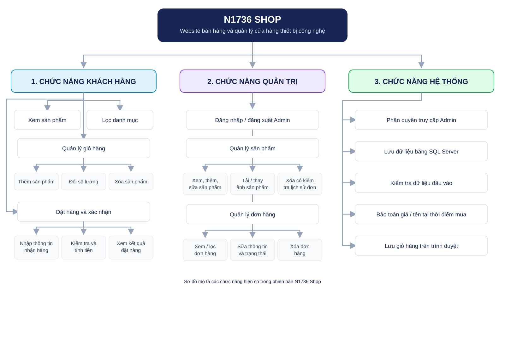

# BÁO CÁO ĐỀ TÀI

## Xây dựng website bán hàng và quản lý cửa hàng thiết bị công nghệ – N1736 Shop

**Sinh viên thực hiện:**

- Đinh Duy Hoàng - V624010 (TN)
- Nguyễn Mạnh Hoàng Anh - V624168
- Hoàng Khắc Nguyên - V624183

**Lớp:** CNTT-VLVH  
**Giảng viên hướng dẫn:** Lại Mạnh Dũng  
**Năm học:** 2026-2027

---

## Mục lục

- [Tóm tắt đề tài](#tóm-tắt-đề-tài)
- [1. Giới thiệu đề tài](#1-giới-thiệu-đề-tài)
  - [1.1. Lý do chọn đề tài](#11-lý-do-chọn-đề-tài)
  - [1.2. Mục tiêu](#12-mục-tiêu)
  - [1.3. Phạm vi và giới hạn](#13-phạm-vi-và-giới-hạn)
- [2. Công nghệ và kiến trúc](#2-công-nghệ-và-kiến-trúc)
  - [2.1. Công nghệ sử dụng](#21-công-nghệ-sử-dụng)
  - [2.2. Mô hình MVC và luồng yêu cầu](#22-mô-hình-mvc-và-luồng-yêu-cầu)
- [3. Thiết kế dữ liệu](#3-thiết-kế-dữ-liệu)
- [4. Các chức năng và nguyên lý hoạt động](#4-các-chức-năng-và-nguyên-lý-hoạt-động)
  - [4.1. Hiển thị và lọc sản phẩm](#41-hiển-thị-và-lọc-sản-phẩm)
  - [4.2. Giỏ hàng](#42-giỏ-hàng)
  - [4.3. Đặt hàng và xác nhận](#43-đặt-hàng-và-xác-nhận)
  - [4.4. Đăng nhập và phân quyền Admin](#44-đăng-nhập-và-phân-quyền-admin)
  - [4.5. Quản lý sản phẩm](#45-quản-lý-sản-phẩm)
  - [4.6. Quản lý đơn hàng](#46-quản-lý-đơn-hàng)
- [5. Các chức năng ứng dụng đạt được](#5-các-chức-năng-ứng-dụng-đạt-được)
- [6. Kiểm thử](#6-kiểm-thử)
- [7. Cấu trúc mã nguồn tiêu biểu](#7-cấu-trúc-mã-nguồn-tiêu-biểu)
- [8. Cài đặt và chạy ứng dụng](#8-cài-đặt-và-chạy-ứng-dụng)
- [9. Kết luận và hướng phát triển](#9-kết-luận-và-hướng-phát-triển)

## Sơ đồ cây phân rã chức năng



## Tóm tắt đề tài

Đề tài xây dựng website N1736 Shop phục vụ hoạt động bán các sản phẩm công nghệ. Khách hàng có thể xem danh sách sản phẩm, lọc theo danh mục, đưa sản phẩm vào giỏ hàng, nhập thông tin nhận hàng và gửi đơn đặt hàng. Quản trị viên đăng nhập vào khu vực Admin để quản lý sản phẩm, ảnh sản phẩm và đơn hàng.

Ứng dụng được xây dựng theo mô hình ASP.NET Core MVC. Dữ liệu được lưu bằng SQL Server và truy cập qua Entity Framework Core. ASP.NET Core Identity đảm nhiệm đăng nhập và phân quyền quản trị. Phần giao diện cửa hàng và trang quản trị được viết bằng Razor, HTML, CSS và JavaScript.

## 1. Giới thiệu đề tài

### 1.1. Lý do chọn đề tài

Website bán hàng giúp khách hàng tiếp cận sản phẩm và gửi yêu cầu mua hàng mà không cần đến cửa hàng trực tiếp. Đối với người quản lý, việc tập trung dữ liệu sản phẩm và đơn đặt hàng trong một ứng dụng giúp theo dõi thông tin, cập nhật trạng thái và hạn chế thao tác rời rạc.

Đề tài chọn nhóm sản phẩm thiết bị công nghệ làm ví dụ, đồng thời triển khai cả luồng mua hàng phía khách hàng lẫn luồng quản trị phía cửa hàng.

### 1.2. Mục tiêu

- Xây dựng trang cửa hàng hiển thị sản phẩm và danh mục.
- Cho phép khách hàng tạo giỏ hàng, nhập thông tin giao hàng và đặt đơn.
- Tính tổng tiền từ giá sản phẩm do máy chủ lưu, không tin giá gửi từ trình duyệt.
- Xây dựng khu vực quản trị được bảo vệ bằng đăng nhập và vai trò Admin.
- Hỗ trợ quản lý sản phẩm, tải ảnh và quản lý thông tin/trạng thái đơn hàng.
- Lưu dữ liệu sản phẩm, đơn hàng và tài khoản trong cơ sở dữ liệu.

### 1.3. Phạm vi và giới hạn

Ứng dụng hiện triển khai quy trình đặt hàng và quản lý đơn hàng cơ bản. Mã nguồn không thể hiện tích hợp thanh toán trực tuyến, quản lý tồn kho, vận chuyển, thông báo qua email/SMS hoặc tài khoản tự đăng ký cho khách hàng. Giỏ hàng được lưu trên trình duyệt bằng `localStorage`; đơn hàng chỉ được lưu khi khách gửi biểu mẫu đặt hàng thành công.

## 2. Công nghệ và kiến trúc

### 2.1. Công nghệ sử dụng

| Thành phần | Công nghệ trong dự án | Vai trò |
| --- | --- | --- |
| Nền tảng | .NET 10, ASP.NET Core | Chạy ứng dụng web và xử lý HTTP |
| Mô hình ứng dụng | ASP.NET Core MVC, Razor Views | Tách xử lý yêu cầu, dữ liệu và giao diện |
| Cơ sở dữ liệu | SQL Server Express | Lưu sản phẩm, đơn hàng và tài khoản |
| Truy cập dữ liệu | Entity Framework Core | Ánh xạ model, truy vấn và migration |
| Xác thực | ASP.NET Core Identity | Đăng nhập, cookie và vai trò Admin |
| Giao diện | HTML, Razor, CSS, Bootstrap, JavaScript | Hiển thị cửa hàng và thao tác trên trình duyệt |
| Kiểm thử | xUnit, ASP.NET Core MVC Testing, SQLite | Kiểm thử luồng HTTP và dữ liệu cô lập |

Thông tin kết nối cơ sở dữ liệu được cấu hình trong cấu hình ứng dụng. Tài khoản Admin được cung cấp qua .NET User Secrets hoặc cấu hình môi trường; không nên ghi mật khẩu trực tiếp vào mã nguồn.

### 2.2. Mô hình MVC và luồng yêu cầu

1. Trình duyệt gửi yêu cầu đến một route, ví dụ `/`, `/Orders/Checkout` hoặc `/Admin/Products`.
2. ASP.NET Core định tuyến yêu cầu đến controller và action tương ứng.
3. Controller dùng `ApplicationDbContext` hoặc `OrderService` để truy vấn/thay đổi dữ liệu.
4. Kết quả được trả về dưới dạng Razor View/Partial View, chuyển hướng, hoặc mã trạng thái HTTP.
5. Trình duyệt hiển thị giao diện và JavaScript xử lý các tương tác như giỏ hàng, lọc sản phẩm.

Trong `Program.cs`, ứng dụng đăng ký MVC, DbContext, Identity và dịch vụ đặt hàng; sau đó cấu hình middleware xác thực/phân quyền và các route:

```csharp
builder.Services.AddControllersWithViews();
builder.Services.AddScoped<OrderService>();
builder.Services.AddDbContext<ApplicationDbContext>(options =>
    options.UseSqlServer(builder.Configuration.GetConnectionString("Sales")));
builder.Services.AddIdentity<ApplicationUser, IdentityRole>()
    .AddEntityFrameworkStores<ApplicationDbContext>()
    .AddDefaultTokenProviders();
```

Route quản trị được ánh xạ theo Area, còn các trang cửa hàng dùng route mặc định:

```csharp
app.MapControllerRoute(
    name: "areas",
    pattern: "{area:exists}/{controller=Orders}/{action=Index}/{id?}");
app.MapControllerRoute(
    name: "default",
    pattern: "{controller=Home}/{action=Index}/{id?}");
```

## 3. Thiết kế dữ liệu

`Data/ApplicationDbContext.cs` kế thừa `IdentityDbContext<ApplicationUser>` và khai báo các tập dữ liệu `Products`, `Orders`, `OrderItems`.

| Thực thể | Dữ liệu tiêu biểu | Mục đích |
| --- | --- | --- |
| `Product` | Tên, mô tả, danh mục, giá, `ImageUrl` | Thông tin sản phẩm |
| `Order` | Tên khách, điện thoại, địa chỉ, ghi chú, thời gian, trạng thái, mã xác nhận, tổng tiền | Thông tin đơn đặt hàng |
| `OrderItem` | Sản phẩm, tên tại thời điểm mua, số lượng, đơn giá tại thời điểm mua | Các dòng sản phẩm trong một đơn |
| `ApplicationUser` | Các trường Identity | Tài khoản đăng nhập quản trị |

Mỗi đơn có nhiều dòng `OrderItem`. Quan hệ đơn hàng – dòng hàng dùng xóa dây chuyền khi xóa đơn. Quan hệ sản phẩm – dòng hàng dùng `DeleteBehavior.Restrict`, để sản phẩm đã xuất hiện trong đơn không thể bị xóa và làm mất lịch sử tham chiếu. Tên sản phẩm và giá tại thời điểm mua cũng được chụp vào `OrderItem`, nên chỉnh sửa giá sản phẩm về sau không làm thay đổi đơn cũ.

`Data/DbInitializer.cs` áp dụng migration khi ứng dụng khởi chạy và tạo bốn sản phẩm mẫu nếu bảng sản phẩm chưa có dữ liệu. Nếu chưa cấu hình thông tin Admin, ứng dụng ghi cảnh báo và không tạo tài khoản Admin.

## 4. Các chức năng và nguyên lý hoạt động

### 4.1. Hiển thị và lọc sản phẩm

`Controllers/HomeController.cs` truy vấn danh mục duy nhất và danh sách sản phẩm để hiển thị trang chủ. Khi khách chọn danh mục, trình duyệt gọi `/Home/Filter`; controller lọc dữ liệu trong cơ sở dữ liệu rồi trả về partial view `_ProductCards`.

```csharp
var products = _db.Products.AsNoTracking();
if (!string.IsNullOrWhiteSpace(category) && category != "all")
{
    products = products.Where(product => product.Category == category);
}

return PartialView("_ProductCards", await products
    .OrderBy(product => product.Name)
    .ToListAsync(cancellationToken));
```

Khi sản phẩm chưa có ảnh, giao diện dùng biểu tượng minh họa theo danh mục; khi có `ImageUrl`, giao diện hiển thị ảnh tương ứng. Danh mục là chuỗi nhập trong biểu mẫu sản phẩm; bộ lọc trên cửa hàng được tạo từ danh mục đang có.

### 4.2. Giỏ hàng

`wwwroot/js/store.js` quản lý giỏ trên trình duyệt bằng khóa `tech-haven-cart` trong `localStorage`. Khách có thể thêm sản phẩm, tăng/giảm số lượng hoặc bỏ sản phẩm. Giao diện tính số lượng và tổng tạm thời để khách tham khảo, sau đó tạo các trường `ProductId` và `Quantity` gửi đến máy chủ.

Giỏ hàng phía trình duyệt không phải nguồn dữ liệu tin cậy để tính tiền. Khi nhận đơn, máy chủ tải lại sản phẩm và giá trong cơ sở dữ liệu.

### 4.3. Đặt hàng và xác nhận

Trang `/Orders/Checkout` cung cấp biểu mẫu tên, số điện thoại, địa chỉ, ghi chú và danh sách sản phẩm. `PlaceOrderInputModel` kiểm tra thông tin bắt buộc, số điện thoại, danh sách hàng không rỗng và không lặp sản phẩm.

`Services/OrderService.cs` tải lại các sản phẩm theo mã, từ chối mã sản phẩm không tồn tại, lấy đơn giá từ database và tính tổng ở máy chủ:

```csharp
var product = products[item.ProductId];
return new OrderItem
{
    ProductId = product.Id,
    ProductName = product.Name,
    Quantity = item.Quantity,
    UnitPrice = product.Price
};
```

Sau đó dịch vụ tạo `Order`, gán trạng thái ban đầu `Pending`, tạo `ConfirmationToken`, tính tổng tiền và lưu đơn cùng các dòng hàng. Nếu dữ liệu không hợp lệ, sản phẩm đã bị xóa hoặc tổng vượt giới hạn, dịch vụ trả lỗi và không lưu đơn. Khi thành công, khách được chuyển đến trang xác nhận theo mã đơn và token.

### 4.4. Đăng nhập và phân quyền Admin

`Controllers/AdminAccountController.cs` xử lý đăng nhập bằng `SignInManager`. Sau đăng nhập thành công, ứng dụng chỉ chuyển về URL trả về nếu đó là URL nội bộ; nếu không, người dùng được đưa đến trang quản lý đơn hàng. Đăng xuất dùng POST và xác thực antiforgery token.

Hai controller Admin đặt thuộc tính `[Authorize(Roles = "Admin")]`. Vì vậy người chưa đăng nhập được chuyển đến trang login, còn người đã đăng nhập nhưng không có vai trò Admin bị từ chối. Tài khoản và vai trò được quản lý bằng Identity.

### 4.5. Quản lý sản phẩm

`Areas/Admin/Controllers/ProductsController.cs` cung cấp danh sách, thêm mới, sửa và xác nhận xóa sản phẩm:

- **Danh sách:** tải sản phẩm theo danh mục và tên.
- **Thêm:** kiểm tra dữ liệu, lưu ảnh nếu có, ghi sản phẩm vào database.
- **Sửa:** cập nhật thông tin; giữ ảnh cũ nếu không chọn ảnh mới.
- **Xóa:** không cho xóa sản phẩm đã có trong đơn hàng.

Ảnh nhận từ trình duyệt được giới hạn ở 5 MB; phần mở rộng, MIME type và chữ ký tệp được kiểm tra để chỉ chấp nhận JPG, PNG hoặc WebP hợp lệ. Ảnh được lưu ở `wwwroot/images/products` dưới tên sinh ngẫu nhiên, còn cột `ImageUrl` lưu đường dẫn tương đối dạng `/images/products/<tên>.jpg`. Khi thay ảnh, ảnh cũ do ứng dụng tạo sẽ bị xóa sau khi lưu thành công; nếu lưu database thất bại, ảnh mới tạm sinh sẽ được dọn.

Ví dụ kiểm tra chữ ký JPEG:

```csharp
".jpg" or ".jpeg" => bytesRead >= 3 &&
    header[0] == 0xff && header[1] == 0xd8 && header[2] == 0xff,
```

### 4.6. Quản lý đơn hàng

`Areas/Admin/Controllers/OrdersController.cs` cho phép Admin:

- Xem danh sách đơn mới nhất trước.
- Lọc theo trạng thái đơn.
- Xem/sửa tên, số điện thoại, địa chỉ, ghi chú và trạng thái.
- Xóa đơn sau thao tác xác nhận.

Các trạng thái trong `Models/OrderStatus.cs` gồm: Chờ xác nhận, Đã xác nhận, Đang giao, Hoàn thành và Đã hủy. Việc sửa thông tin khách hoặc trạng thái không sửa giá và tên sản phẩm đã lưu ở dòng hàng của đơn.

## 5. Các chức năng ứng dụng đạt được

1. Trang cửa hàng hiển thị danh sách sản phẩm, giá, hình ảnh hoặc biểu tượng thay thế.
2. Lọc sản phẩm theo danh mục mà không phải tải lại toàn bộ trang.
3. Giỏ hàng hoạt động trên trình duyệt và lưu giữa các lần tải lại trang trên cùng trình duyệt.
4. Biểu mẫu đặt hàng kiểm tra thông tin người nhận và dữ liệu sản phẩm.
5. Máy chủ xác minh sản phẩm và tính tiền từ dữ liệu cơ sở dữ liệu, đồng thời lưu chi tiết đơn theo giá tại thời điểm mua.
6. Trang xác nhận đơn hàng được bảo vệ bằng mã xác nhận.
7. Admin đăng nhập và phân quyền truy cập khu vực quản trị.
8. Admin thêm/sửa/xóa sản phẩm, tải ảnh sản phẩm và thay ảnh.
9. Admin xem/lọc/sửa/xóa đơn và cập nhật trạng thái.
10. Dữ liệu được lưu trong SQL Server; cấu trúc dữ liệu được quản lý bằng Entity Framework Core migrations.

## 6. Kiểm thử

Dự án có bộ kiểm thử xUnit tại `final.Tests`. `TestWebApplicationFactory` thay SQL Server bằng SQLite trong bộ nhớ, giúp kiểm tra các yêu cầu HTTP và dữ liệu mà không cần dùng dữ liệu cửa hàng thật.

Các nhóm kiểm thử tiêu biểu:

- Hiển thị cửa hàng, lọc danh mục và ảnh sản phẩm.
- Tạo đơn, kiểm tra dữ liệu không hợp lệ, mã sản phẩm không tồn tại và tính tiền theo giá phía máy chủ.
- Kiểm tra người chưa đăng nhập/người không phải Admin không truy cập được khu vực quản trị.
- Quản lý đơn, kiểm tra snapshot giá và ràng buộc không xóa sản phẩm đã có trong đơn.
- Tải ảnh hợp lệ/không hợp lệ và xử lý ảnh khi tạo, sửa, xóa sản phẩm.

## 7. Cấu trúc mã nguồn tiêu biểu

| Đường dẫn | Nội dung |
| --- | --- |
| `Program.cs` | Đăng ký dịch vụ, middleware và route |
| `Controllers/` | Trang cửa hàng, đặt hàng và đăng nhập |
| `Areas/Admin/Controllers/` | Quản lý sản phẩm và đơn hàng |
| `Areas/Admin/Views/` | Giao diện quản trị |
| `Views/` | Giao diện cửa hàng, checkout, đăng nhập, xác nhận |
| `Models/` | Các thực thể dữ liệu |
| `ViewModels/` | Dữ liệu biểu mẫu và quy tắc kiểm tra |
| `Data/` | DbContext, khởi tạo dữ liệu và migrations |
| `Services/OrderService.cs` | Nghiệp vụ tạo đơn hàng |
| `wwwroot/js/` | Tương tác giỏ hàng và trang checkout |
| `wwwroot/css/` | Giao diện cửa hàng, quản trị và checkout |
| `final.Tests/` | Kiểm thử tích hợp |

## 8. Cài đặt và chạy ứng dụng

Điều kiện chạy theo cấu hình hiện tại: .NET 10 SDK và SQL Server Express đang hoạt động.

1. Mở PowerShell tại thư mục dự án.
2. Cấu hình tài khoản Admin bằng User Secrets:

   ```powershell
   dotnet user-secrets set "Admin:Username" "admin"
   dotnet user-secrets set "Admin:Password" "Mat_khau"
   ```

3. Chạy ứng dụng:

   ```powershell
   dotnet run
   ```

4. Mở URL được in trong terminal. Đăng nhập tại `/AdminAccount/Login`; quản lý đơn tại `/Admin/Orders`; quản lý sản phẩm tại `/Admin/Products`.

Chạy kiểm thử bằng:

```powershell
dotnet test .\final.Tests\final.Tests.csproj
```

## 9. Kết luận và hướng phát triển

Đề tài đã xây dựng được quy trình bán hàng cơ bản từ xem sản phẩm, tạo giỏ, gửi đơn đến quản trị sản phẩm và theo dõi trạng thái đơn hàng. Việc tính tiền ở máy chủ, phân quyền Admin, kiểm tra dữ liệu và lưu snapshot sản phẩm/giá góp phần bảo vệ tính nhất quán của đơn.

Các hướng có thể phát triển tiếp gồm tích hợp cổng thanh toán, quản lý tồn kho, tìm kiếm/phân trang, quản lý khách hàng, thông báo đơn hàng, báo cáo doanh thu theo thời gian và lưu ảnh trên dịch vụ lưu trữ riêng khi triển khai production. Đây là các hướng đề xuất, chưa phải chức năng đã có trong phiên bản hiện tại.

---

**Tên đề tài:** Xây dựng website bán hàng và quản lý cửa hàng thiết bị công nghệ – N1736 Shop  
**Thư mục mã nguồn:** `D:\project ưeb\final`  
**Repository:** [https://github.com/hoanghaidz0789-gif/QLBanhang](https://github.com/hoanghaidz0789-gif/QLBanhang)
